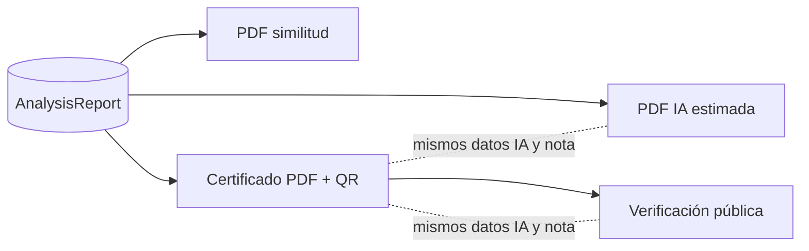

G1: Pendiente — el Gerente TI aprueba cambiando esta línea a "G1: Aprobado por Gerente TI <fecha>"

# ORI-CER_HU_CU_v1 — Reportes, certificado e informes PDF
Estado: G0 (requisito nuevo del cliente) · Dueño: ASP (Gerente, D-05)

## Objetivo y actores
Entregar dos informes PDF imprimibles (similitud e IA estimada) y un certificado cuyos datos coinciden con la verificación pública por QR. Actores: Docente, Estudiante, Tercero verificador, Sistema.

## Historias de usuario
| ID | Historia | Etiqueta |
|---|---|---|
| HU-CER-01 | Como docente quiero ver el reporte con hallazgos y fuentes | [Supuesto] (en prod) |
| HU-CER-02 | Como estudiante quiero un certificado PDF cuando el riesgo lo permite | [Supuesto] (en prod) |
| HU-CER-03 | Como tercero quiero verificar un certificado escaneando el QR | [Supuesto] (en prod) |
| HU-CER-04 | (#1) Error 500 al verificar por QR | [Supuesto] No reproducible en servidor; falta URL real |
| HU-CER-05 | (#7) "Documento señalado" | [Supuesto] Ya en repo; se absorbe en HU-CER-06/07 |
| HU-CER-06 | Como docente quiero un **PDF de similitud** imprimible con % total, desglose interno/web, fuentes y segmentos señalados | [Decisión Gerente] D-09 |
| HU-CER-07 | Como docente quiero un **PDF de IA estimada** imprimible con %, banda, segmentos señalados, método y limitaciones | [Decisión Gerente] D-08/D-09 |
| HU-CER-08 | Como estudiante quiero que el certificado muestre "IA estimada" con banda, fecha, versión del motor y nota de uso responsable | [Decisión Gerente] D-08 |
| HU-CER-09 | Como tercero quiero que el QR muestre los mismos datos y la misma advertencia que el certificado | [Decisión Gerente] D-08 |
| HU-CER-10 | Como estudiante con certificado previo quiero poder pedir su reemisión con la nota | [Decisión Gerente] D-11 (opcional) |

## Casos de uso
**CU-CER-03 Descargar PDF de similitud.** Pre: reporte terminado; usuario con permiso sobre el documento. Flujo: genera PDF con cabecera institucional, % total, desglose interno/web, tabla de fuentes, texto con segmentos señalados y nota de cálculo → descarga. Alterno: reporte no terminado → mensaje.
**CU-CER-04 Descargar PDF de IA estimada.** Igual, con %, banda, segmentos con probabilidad, método (modelo, versión), limitaciones y nota de uso responsable.
**CU-CER-05 Verificar por QR.** Muestra código, fecha, versión del motor, % similitud, "IA estimada" con banda y la misma nota del certificado; nunca el texto del documento.
**CU-CER-06 Reemitir certificado** (opcional, D-11). El certificado anterior queda inactivo y el nuevo trae la nota.

## Reglas de negocio
| ID | Regla | Etiqueta |
|---|---|---|
| RN-CER-01 | Riesgo Alto o Crítico bloquea el certificado (solo por similitud) | [Decisión Gerente] D-03/D-04 |
| RN-CER-02 | Todo % de IA se rotula "IA estimada" y va con la nota de uso responsable: estimación, no prueba, requiere revisión humana | [Decisión Gerente] D-08 |
| RN-CER-03 | Certificado, PDF de IA y QR muestran el mismo valor, banda, fecha, versión del motor y nota | [Decisión Gerente] D-08 |
| RN-CER-04 | La verificación pública no expone el texto del documento ni sus segmentos | [Supuesto] (confidencialidad) |
| RN-CER-05 | Los 13 certificados emitidos siguen válidos | [Decisión Gerente] D-11 |
| RN-CER-06 | La spec define cómo se calcula el % total (unión de segmentos sin doble conteo) y explica por qué la suma de % por fuente puede superarlo (un segmento coincide con varias fuentes) | [Decisión Gerente] D-09 |
| RN-CER-07 | Los PDF se diseñan para impresión A4 (márgenes, paginación "Página X de N", sin depender del color para leer) | [Propuesto] |

## Criterios EARS
| ID | Criterio | HU | Verificable |
|---|---|---|---|
| AC-CER-01 | CUANDO un tercero abre la verificación de un certificado activo, EL SISTEMA DEBE responder 200 con los datos de RN-CER-03 | HU-CER-03/09 | Sí (Playwright) |
| AC-CER-02 | SI el hash no existe o el certificado está inactivo, ENTONCES EL SISTEMA DEBE mostrar "no válido" sin error 500 | HU-CER-04 | Sí |
| AC-CER-03 | CUANDO se genera el PDF de similitud, EL SISTEMA DEBE incluir % total, % interno, % web, fuentes con su % y segmentos señalados | HU-CER-06 | Sí (test de contenido PDF) |
| AC-CER-04 | CUANDO se genera el PDF de similitud, EL SISTEMA DEBE incluir la nota de cálculo de RN-CER-06 | HU-CER-06 | Sí |
| AC-CER-05 | CUANDO se genera el PDF de IA, EL SISTEMA DEBE incluir %, banda, fecha, versión del motor, segmentos señalados, método, limitaciones y nota de uso responsable | HU-CER-07 | Sí |
| AC-CER-06 | CUANDO se muestran el certificado y su verificación QR, EL SISTEMA DEBE mostrar valores idénticos de IA, banda, fecha, versión y nota | HU-CER-08/09 | Sí (Playwright + PDF) |
| AC-CER-07 | SI el usuario no tiene permiso sobre el documento, ENTONCES EL SISTEMA DEBE negar la descarga de ambos PDF | HU-CER-06/07 | Sí |
| AC-CER-08 | El PDF debe "verse bien" impreso | HU-CER-06/07 | **No verificable** → usar RN-CER-07 como criterio |

## Diagrama

## Preguntas abiertas
| # | Pregunta | Responsable | Bloqueante |
|---|---|---|---|
| 1 | ¿Quién descarga cada PDF: docente, estudiante o ambos? | Gerente | Sí (G1) |
| 2 | ¿El PDF de similitud reemplaza al "Documento señalado" actual o convive? | Gerente | Sí (G1) |
| 3 | ¿Texto exacto de la nota de uso responsable? (propuesto: base AI_ESTIMATE_DISCLAIMER + "requiere revisión humana") | Gerente | Sí (G1) |
| 4 | ¿La verificación QR muestra el nombre del estudiante? (hoy sí) | Gerente | No |
| 5 | URL real del QR para cerrar #1 | Gerente | Sí para HU-CER-04 |

## Historial
| Versión | Fecha | Autor | Cambio |
|---|---|---|---|
| v0 | 2026-11-06 | Claude PM | Ingeniería inversa del repo |
| v1 | 2026-11-06 | Claude PM | Requisito del cliente: dos PDF, IA en certificado y QR (D-08..D-11); HU-CER-06..10 en G0 |

## Respuestas a las preguntas bloqueantes [Propuesto por Claude PM — vigentes solo si el Gerente aprueba G1]
1. Descargan ambos PDF: el docente/staff de la institución y el estudiante dueño del documento. Nadie más (AC-CER-07).
2. El PDF de similitud reemplaza al "Documento señalado" actual (ruta `download_highlighted`), reutilizando su código de resaltado.
3. Nota de uso responsable (texto único en certificado, PDF de IA y QR): "IA estimada: valor probabilístico calculado por un modelo automático. No constituye prueba del uso de inteligencia artificial y requiere la revisión de un docente antes de cualquier decisión académica."
4. La verificación QR mantiene el nombre del estudiante (como hoy).
5. #1 (500 del QR) queda fuera de este alcance hasta tener la URL real.
