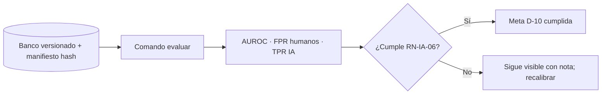

G1: Pendiente — el Gerente TI aprueba cambiando esta línea a "G1: Aprobado por Gerente TI <fecha>"

# ORI-IA_HU_CU_v2 — Detección de contenido IA
Estado: G1 en curso · Dueño: ASP (Gerente, D-05) · Alcance v2: #3, #5 y requisito del cliente (D-08, D-10)

## Objetivo y actores
Que el % de IA sea una estimación medida y honesta: evaluable de forma reproducible y siempre acompañada de su advertencia. Actores: Gerente/Desarrollador, Docente, Estudiante, Tercero (verificación pública), Sistema.

## Historias de usuario
| ID | Historia | Etiqueta |
|---|---|---|
| HU-IA-01 | Como docente quiero un % estimado de IA con su advertencia de que no es concluyente | [Supuesto] (en prod) |
| HU-IA-02 | Como Gerente quiero un banco de evaluación versionado y un comando que lo evalúe y dé siempre el mismo resultado | [Propuesto] #3 |
| HU-IA-03 | Como Gerente quiero saber cuántos textos humanos marca el detector (falsos positivos) antes de mostrarlo | [Propuesto] #3 |
| HU-IA-04 | ~~Ocultar el % de IA mientras no esté recalibrado~~ | **Descartada** por D-08 (cliente exige IA visible) |
| HU-IA-05 | Como docente quiero ver el % como "IA estimada" con banda, fecha, versión del motor y nota de uso responsable | [Decisión Gerente] D-08 |
| HU-IA-07 | Como Gerente quiero saber si el detector cumple la meta FPR ≤ 2 % (cota superior IC 95 %) con ≥150 tesis humanas representativas | [Decisión Gerente] D-10 |
| HU-IA-08 | Como docente quiero ver qué segmentos aportan al % de IA (con su probabilidad) en el PDF de IA | [Decisión Gerente] D-08 (ver ORI-CER HU-CER-07) |
| HU-IA-06 | (#4) Ventana deslizante para perplejidad | [Propuesto] Diferida: D-02 cambia la base a clasificador |

## Casos de uso
**CU-IA-01 Estimar IA** (en prod). Texto filtrado → clasificador BETO por trozos → % + rango + AI_ESTIMATE_DISCLAIMER. [Supuesto]
**CU-IA-02 Evaluar detector.** Actor: Gerente. Pre: banco versionado (manifiesto con hash de cada texto). Flujo: ejecuta el comando de evaluación → calcula AUROC, FPR en humanos por año y TPR en IA → guarda reporte con fecha, commit y hash del banco. Alterno: falta un texto o el hash no coincide → aborta con mensaje.
**CU-IA-03 Verificar meta de calibración.** El comando de evaluación calcula la cota superior del IC 95 % del FPR sobre el conjunto humano de prueba e indica CUMPLE / NO CUMPLE frente a D-10.

## Reglas de negocio
| ID | Regla | Etiqueta |
|---|---|---|
| RN-IA-01 | El % de IA no afecta riesgo ni certificado | [Decisión Gerente] D-03/D-04 |
| RN-IA-02 | Línea base: clasificador BETO; rollback AI_DETECTION_MODE=global | [Decisión Gerente] D-02 |
| RN-IA-03 | Toda salida del % lleva la advertencia de estimación no concluyente | [Validado con usuario] |
| RN-IA-04 | El banco no incluye tesis del instituto fuera del servidor/PC (no Colab ni terceros); solo textos públicos (UPeU, Wikipedia) e IA generada | [Propuesto] (confidencialidad) |
| RN-IA-05 | Split fijo con semilla; humanos de control ≤2021 | [Supuesto] (repo: exportar_dataset_ia, MAX_YEAR=2021, SEED=20261104) |
| RN-IA-06 | Meta: FPR ≤ 2 % (cota superior IC 95 %) con ≥150 tesis humanas representativas | [Decisión Gerente] D-10 |
| RN-IA-07 | La IA es visible en certificado, PDF de IA y QR, siempre con etiqueta "IA estimada" y nota de uso responsable | [Decisión Gerente] D-08 |
| RN-IA-08 | El PDF de IA y el QR usan la misma versión del motor que generó el reporte (no la actual) | [Propuesto] |

## Criterios EARS
| ID | Criterio | HU | Verificable |
|---|---|---|---|
| AC-IA-01 | CUANDO se muestra un % de IA, EL SISTEMA DEBE mostrar junto a él la advertencia de estimación no concluyente | HU-IA-01/05 | Sí (Playwright) |
| AC-IA-02 | CUANDO el Gerente ejecuta la evaluación dos veces sobre el mismo banco y commit, EL SISTEMA DEBE producir métricas idénticas | HU-IA-02 | Sí |
| AC-IA-03 | SI un texto del manifiesto falta o su hash no coincide, ENTONCES EL SISTEMA DEBE abortar la evaluación indicando cuál | HU-IA-02 | Sí |
| AC-IA-04 | CUANDO termina la evaluación, EL SISTEMA DEBE reportar AUROC, FPR en humanos (por año), TPR en IA, n humanos, cota superior IC 95 % del FPR y veredicto frente a D-10, con commit y hash del banco | HU-IA-03/07 | Sí |
| AC-IA-07 | SI el conjunto humano de prueba tiene menos de 150 tesis, ENTONCES EL SISTEMA DEBE marcar la evaluación como "insuficiente" | HU-IA-07 | Sí |
| AC-IA-05 | CUANDO se muestra el % de IA en reporte, certificado, PDF de IA o QR, EL SISTEMA DEBE mostrar "IA estimada", banda, fecha, versión del motor y la nota de uso responsable | HU-IA-05 | Sí (Playwright + test PDF) |

## Diagrama

## Preguntas abiertas
| # | Pregunta | Responsable | Bloqueante |
|---|---|---|---|
| 1 | ¿Método del IC 95 %: Clopper-Pearson bilateral o unilateral? Con 150 humanas y 0 falsos positivos, el unilateral da 1,98 % (cumple) y el bilateral 2,43 % (no cumple). Con 1 falso positivo ninguno cumple con 150. Tesis humanas mínimas para cumplir: 0 FP → 149 / 183; 1 FP → 236 / 277; 2 FP → 313 / 359 (unilateral / bilateral) | Gerente | **Sí** |
| 2 | ¿Qué es "representativas"? El instituto no tiene tesis digitales anteriores a 2022 y sus tesis no deben salir a terceros (RN-IA-04) | Gerente | **Sí** |
| 3 | ¿Dónde vive el banco: fuera del repo con manifiesto versionado? | Gerente | No (propuesto: sí) |
| 4 | ¿Se cierra #4 (ventana deslizante) como diferido por D-02? | Gerente | No |

## Historial
| Versión | Fecha | Autor | Cambio |
|---|---|---|---|
| v0 | 2026-11-06 | Claude PM | Ingeniería inversa del repo main b430bb0 |
| v1 | 2026-11-06 | Claude PM | Alcance #3/#5 según D-02, D-03, D-07; EARS verificables; #4 diferido |
| v2 | 2026-11-06 | Claude PM | D-08/D-10: IA visible con mitigaciones; HU-IA-04 descartada; meta FPR ≤2 % |

## Respuestas a las preguntas bloqueantes [Propuesto por Claude PM — vigentes solo si el Gerente aprueba G1]
1. IC 95 % de Clopper-Pearson **bilateral** (cota superior al 97,5 %), el más estándar y defendible. Mínimo práctico: 183 tesis humanas con 0 falsos positivos; con 1 FP, 277.
2. "Representativas": tesis humanas en español del área de educación/pedagogía, de repositorios públicos peruanos, fechadas ≤2021 (antes de los LLM públicos), con al menos 3 instituciones distintas. Las tesis del instituto solo se evalúan en el servidor o la PC del Gerente, nunca en Colab ni servicios de terceros.
3. El banco vive fuera del repo (`eval_ia/`); en el repo va un manifiesto versionado con ruta relativa, etiqueta, año, institución y SHA-256 de cada texto.
4. #4 (ventana deslizante) queda diferido.
